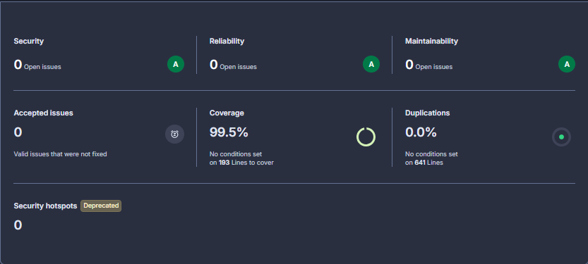

# Payment Mock — AutoShop

Serviço que **simula a API do Mercado Pago** usada pelo
[Billing Service](https://github.com/Jackeline2020/billing-autoshop).
Permite demonstrar e testar o fluxo de pagamento, incluindo pagamentos
recusados e estornos, sem depender de credenciais externas.

O Billing usa o mesmo código para falar com o Mercado Pago real e com
este mock; muda apenas a configuração (URL, `client_id` e
`client_secret`). A decisão está no
[ADR-007](https://github.com/Jackeline2020/app-autoshop/blob/develop/docs/adr/ADR-007-pagamento.md).

## Fluxo simulado (Checkout Pro)

1. O Billing obtém um token com `client_id` e `client_secret`.
2. O Billing cria um link de pagamento (preferência) com o valor da OS e
   o endereço do seu webhook.
3. Após alguns segundos, o mock simula o pagamento do cliente.
4. O mock chama o webhook do Billing informando o ID do pagamento.
5. O Billing consulta o pagamento para saber se foi aprovado ou recusado.
6. Se necessário, o Billing solicita o estorno (compensação da Saga).

| Valor do pagamento | Resultado |
|---|---|
| Termina em `,13` (ex.: R$ 350,13) | Recusado (`rejected`) |
| Qualquer outro | Aprovado (`approved`) |

## Rotas

| Método | Rota | Descrição |
|---|---|---|
| `GET` | `/health` | Health check |
| `POST` | `/oauth/token` | Emite o token (`grant_type=client_credentials`) |
| `POST` | `/checkout/preferences` | Cria o link de pagamento * |
| `GET` | `/checkout/{id}` | Página do link de pagamento |
| `GET` | `/v1/payments/{id}` | Consulta o pagamento * |
| `POST` | `/v1/payments/{id}/refunds` | Estorna um pagamento aprovado * |

\* Exige `Authorization: Bearer <token>`.

## Configuração

| Variável | Padrão | Descrição |
|---|---|---|
| `PORT` | `8080` | Porta HTTP |
| `MOCK_CLIENT_ID` | `autoshop-client` | Client ID aceito |
| `MOCK_CLIENT_SECRET` | `autoshop-secret` | Client secret aceito |
| `MOCK_PUBLIC_URL` | `http://localhost:8080` | Endereço usado no link de pagamento |
| `MOCK_PAYMENT_DELAY` | `5s` | Tempo até o pagamento simulado |
| `MOCK_TOKEN_TTL` | `1h` | Validade do token |

## Como rodar localmente

```bash
docker compose up --build

TOKEN=$(curl -s -X POST http://localhost:8090/oauth/token \
  -H "Content-Type: application/json" \
  -d '{"grant_type":"client_credentials","client_id":"autoshop-client","client_secret":"autoshop-secret"}' \
  | sed -E 's/.*"access_token":"([^"]+)".*/\1/')

curl -s -X POST http://localhost:8090/checkout/preferences \
  -H "Authorization: Bearer $TOKEN" -H "Content-Type: application/json" \
  -d '{"items":[{"title":"OS 123","quantity":1,"unit_price":350}],"external_reference":"os-123"}'
```

Os dados ficam em memória e são perdidos ao reiniciar o serviço.

## Testes

```bash
go test ./... -coverprofile=coverage.out
./scripts/coverage.sh
```

## Cobertura e qualidade

O pipeline exige **cobertura mínima de 80%** (`scripts/coverage.sh`) e
envia a análise para o SonarCloud.

Resultado no SonarCloud (branch `main`): **99,5% de cobertura**, nota A em
segurança, confiabilidade e manutenibilidade, e 0% de duplicação.
Projeto: [Jackeline2020_payment-mock-autoshop](https://sonarcloud.io/project/overview?id=Jackeline2020_payment-mock-autoshop).



## CI/CD

Pipeline em `.github/workflows/ci-cd.yml`: build, `go vet`, testes,
cobertura mínima de 80%, SonarCloud, publicação da imagem Docker no
GitHub Container Registry e, na `main`, deploy no EKS
(`scripts/deploy-aws.sh`, habilitado pela variável `AWS_DEPLOY_ENABLED`).
No cluster, o mock só é acessível internamente (`ClusterIP`). As branches
`main` e `develop` são protegidas e só recebem alterações por pull request
com as checagens aprovadas.

Secrets usados: `AWS_ROLE_ARN`, `SONAR_TOKEN`.
